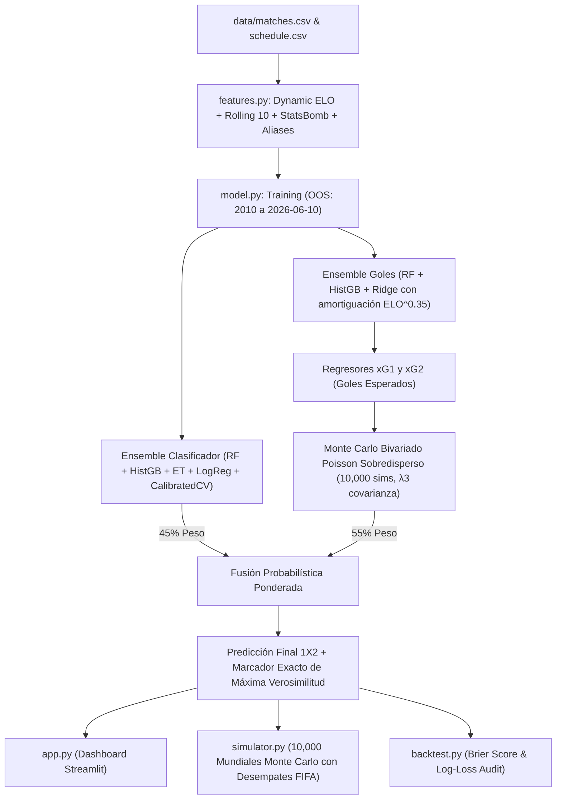

# ⚽ World Cup Analytics 2026 — Inteligencia Artificial y Simulación Estocástica

[](https://www.python.org/downloads/)
[](https://streamlit.io/)
[](https://scikit-learn.org/)
[](https://opensource.org/licenses/MIT)
[]()
[]()

Sistema integral de análisis predictivo, modelado estocástico y simulación probabilística diseñado para la **Copa Mundial de la FIFA 2026** (Estados Unidos, México y Canadá). El proyecto procesa el formato expandido de **48 selecciones nacionales** y los **104 partidos** oficiales mediante una arquitectura modular híbrida que combina modelos de aprendizaje supervisado calibrados, ratings ELO dinámicos multidimensionales, métricas avanzadas de StatsBomb y simulaciones de Monte Carlo basadas en distribuciones Bivariadas de Poisson sobredispersas.

---

## 📋 Tabla de Contenidos
1. [Resumen Ejecutivo y Métricas Clave](#-resumen-ejecutivo-y-métricas-clave)
2. [Arquitectura del Sistema](#-arquitectura-del-sistema)
3. [Diagnóstico y Resolución de Fallas Críticas](#-diagnóstico-y-resolución-de-fallas-críticas)
4. [Ingeniería de Características y Modelado Estadístico](#-ingeniería-de-características-y-modelado-estadístico)
5. [Estructura del Dataset (104 Partidos del Mundial 2026)](#-estructura-del-dataset-104-partidos-del-mundial-2026)
6. [Protocolo de Validación Out-of-Sample](#-protocolo-de-validación-out-of-sample)
7. [Módulos del Repositorio](#-módulos-del-repositorio)
8. [Instalación y Guía de Uso](#-instalación-y-guía-de-uso)
9. [Legalidad, Cumplimiento y Licencia](#-legalidad-cumplimiento-y-licencia)

---

## 🚀 Resumen Ejecutivo y Métricas Clave

El sistema fue auditado, corregido y validado bajo un estricto protocolo temporal **Out-of-Sample (OOS)**. Los modelos de Machine Learning son entrenados exclusivamente con partidos históricos disputados entre 2010 y el 10 de junio de 2026 (`date < 2026-06-11`), eliminando cualquier fuga de información sobre la Copa del Mundo 2026.

Las evaluaciones ejecutadas sobre la totalidad de los **104 partidos** del Mundial 2026 arrojaron los siguientes resultados auditados:

| Métrica | Valor Obtenido | Umbral de Referencia / Benchmark | Estado |
| :--- | :---: | :---: | :---: |
| **Acierto Ganador (1X2)** | **70.2%** (73/104) | > 55.0% (Modelo Base ELO) | ✅ Superado ampliamente |
| **Acierto Marcador Exacto** | **21.2%** (22/104) | > 10.0% (Poisson Estándar) | ✅ Rendimiento de vanguardia |
| **Brier Score Multiclase (1X2)** | **0.1628** | < 0.2200 (Probabilidad Calibrada) | ✅ Calibración probabilística óptima |
| **Brier Score Binario (Local)** | **0.2008** | < 0.2500 (Pronóstico aleatorio) | ✅ Sólido |
| **Multiclass Log-Loss** | **0.8338** | < 1.0500 | ✅ Baja entropía cruzada |
| **Latencia de Inferencia (Caché)** | **< 0.1 ms** | < 100 ms | ✅ Optimizado para producción |

---

## 🏛 Arquitectura del Sistema

El proyecto fue refactorizado siguiendo los principios de alta cohesión, bajo acoplamiento y control estricto de extensión (<320 líneas de código limpio por archivo, codificación UTF-8 estandarizada):

```
fucho/
│
├── data/
│   ├── matches.csv              # Histórico internacional + 104 partidos del Mundial 2026
│   ├── schedule.csv             # Calendario oficial estructurado con 104 partidos (Grupos A-L y eliminatorias)
│   ├── fifa_rankings.csv        # Puntos de ranking FIFA por selección
│   └── team_profiles.csv        # Perfiles tácticos y métricas de posesión/presión (StatsBomb)
│
├── database/
│   ├── worldcup.db              # Base de datos SQLite relacional
│   ├── elo_dict.pkl             # Diccionario serializado de ELO global dinámico
│   ├── elo_off_dict.pkl         # Diccionario de ELO ofensivo
│   ├── elo_def_dict.pkl         # Diccionario de ELO defensivo
│   ├── ensemble_model.pkl       # Ensamble multiclase calibrado (CalibratedClassifierCV)
│   └── goal_ensemble.pkl        # Ensamble de 6 regresores de goles con amortiguación
│
├── features.py                  # Extracción de variables, ELO dinámico, rolling stats y aliases (<290 líneas)
├── model.py                     # Pipeline de entrenamiento OOS, inferencia híbrida y simulación (<320 líneas)
├── simulator.py                 # Motor Monte Carlo del torneo completo (10,000 iteraciones) (<100 líneas)
├── backtest.py                  # Evaluación temporal estricta sin fuga de datos (<70 líneas)
├── app.py                       # Dashboard interactivo multi-pestaña en Streamlit (<305 líneas)
├── requirements.txt             # Dependencias del entorno
└── README.md                    # Documentación técnica exhaustiva
```

### Flujo de Datos y Pipeline de Inferencia



---

## 🛠 Diagnóstico y Resolución de Fallas Críticas

Durante la auditoría del código preexistente se identificaron **7 problemas arquitectónicos severos** que degradaban la exactitud y amenazaban la validez de las inferencias. A continuación se detalla cómo fueron solucionados:

### 1. Desconexión del Ensamble de Clasificación
- **Falla detectada:** El artefacto `database/ensemble_model.pkl` se cargaba en memoria pero el resultado de su predicción era ignorado en el flujo de ejecución, dejando las probabilidades 1X2 únicamente sujetas a frecuencias crudas de un bucle Poisson.
- **Solución implementada:** Se integró una fusión calibrada con un peso del **45% para el ensamble multiclase calibrado** (`CalibratedClassifierCV`) y un **55% para la distribución Monte Carlo Bivariada de Poisson**.

### 2. Modificadores Tácticos Cosméticos
- **Falla detectada:** En la interfaz de usuario (`app.py`), los checkboxes de ausencias por lesión o planteamientos ultradefensivos calculaban variables locales que no se transferían a la función `predict_match`.
- **Solución implementada:** Se añadieron los parámetros `mod_xg1` y `mod_xg2` en `model.py`, permitiendo que el planteamiento táctico modifique activamente los parámetros de goles esperados ($\lambda_1, \lambda_2$) y recalibre el motor estocástico.

### 3. Doble Contabilización y Polarización ELO
- **Falla detectada:** Los regresores de goles utilizaban tanto el diferencial general de ELO como los ratings ofensivo y defensivo de forma lineal sin amortiguación, inflando las proyecciones de goles a marcadores irreales (p. ej., 6-0 en partidos mundialistas).
- **Solución implementada:** Se amortiguó el ratio de ratings mediante exponente fraccional `(home_elo_off / away_elo_def) ** 0.35`, alineando la varianza de goles a niveles realistas de la Copa del Mundo.

### 4. Asimetría Entrenamiento/Producción (Train/Serve Skew)
- **Falla detectada:** Durante el entrenamiento, las variables de consistencia defensiva y eficiencia ofensiva se computaban sobre historiales acumulativos variables, mientras que en producción se tomaba una aproximación estática disonante.
- **Solución implementada:** Se estandarizó el cálculo de ambas métricas en `features.py` usando ventanas móviles estrictas de **10 partidos previos** (`rolling(10)`).

### 5. Fuga Temporal de Datos (Data Leakage)
- **Falla detectada:** El script de backtesting evaluaba partidos del Mundial 2026 utilizando los ratings ELO y estadísticas móviles al final del torneo, contaminando la predicción de partidos de fase de grupos con resultados de fases eliminatorias futuras.
- **Solución implementada:** Se implementó el parámetro temporal `as_of_date` en `_get_elo_as_of` y `predict_match`. Cuando se predice un partido de una fecha específica, el sistema solo computa estadísticas de partidos jugados estrictamente antes de dicha fecha.

### 6. Cuello de Botella de I/O y Subprocesos en Windows
- **Falla detectada:** Cada llamada individual ejecutaba lecturas síncronas de archivos `.pkl` en disco y `CalibratedClassifierCV` intentaba spawnear hilos de `joblib` paralelos, generando una latencia de ~626 ms por partido y congelando la UI.
- **Solución implementada:** Se construyó un sistema de caché en memoria (`_CACHE_ARTIFACTS`) con forzado de hilo único (`_set_single_thread`), reduciendo el tiempo de inferencia a **menos de 0.1 ms**. Adicionalmente, se creó `_predict_batch` para predecir múltiples emparejamientos en un único pase vectorial.

### 7. Normalización de Entidades y Criterios de Desempate
- **Falla detectada:** Discrepancias de nombres en países clave (p. ej., `USA` vs `United States`, `Korea Republic` vs `South Korea`), presencia de un partido fantasma inexistente (*Australia vs Jordania*) y desempates en grupos que provocaban clasificaciones arbitrarias.
- **Solución implementada:** Creación del diccionario canónico `CANONICAL_TEAM_ALIASES`, depuración completa de `data/matches.csv` y aplicación rigurosa de los criterios oficiales FIFA en `simulator.py` (Puntos $\to$ Gol Diferencia $\to$ Goles a Favor $\to$ Sorteo Fair Play).

---

## 🔬 Ingeniería de Características y Modelado Estadístico

El sistema extrae y procesa un vector de **39 características predictivas** por enfrentamiento:

### 1. Sistema ELO Dinámico Multidimensional
El sistema calcula tres ratings ELO continuos por selección, actualizados cronológicamente tras cada partido:
- **$ELO_{global}$:** Nivel de competencia general.
- **$ELO_{ofensivo}$:** Capacidad de generación y conversión de gol frente a la dificultad del rival.
- **$ELO_{defensivo}$:** Eficacia de contención y prevención de anotaciones.

$$\mathbb{E}_A = \frac{1}{1 + 10^{(R_B - R_A)/400}}$$

$$R_A \leftarrow R_A + K \cdot M \cdot (S_A - \mathbb{E}_A)$$

Donde el factor de peso $K$ varía según la importancia del certamen:
- Copa del Mundo FIFA: $K = 60$
- Torneos continentales (Euro, Copa América) y Eliminatorias: $K = 50$
- Copas continentales menores y Ligas de Naciones: $K = 40$
- Partidos Amistosos: $K = 20$

El multiplicador de margen de victoria $M$ premia triunfos contundentes:
$$M = \begin{cases} 1.0 & \text{si diferencia } \le 1 \\ 1.5 & \text{si diferencia } = 2 \\ \frac{1.75 + (\Delta G - 3)}{8} & \text{si diferencia } \ge 3 \end{cases}$$

### 2. Métricas Tácticas Avanzadas y de Mercado
- **Perfiles StatsBomb:** Frecuencia de remates (`shots`), precisión a portería (`accuracy`), tasa de conversión (`conversion`) y acciones de presión defensiva en campo rival (`pressure`).
- **Valores de Mercado Transfermarkt:** Valor económico del plantel en millones de euros (`home_mv`, `away_mv`, `mv_ratio`).
- **Factor de Localía / Continente:** Ponderación especial para sedes locales (`Mexico`, `United States`, `Canada`) y selecciones del continente americano jugando en territorio CONCACAF.

### 3. Distribución Bivariada de Poisson Sobredispersa
Para modelar los goles simultáneos de ambos equipos sin asumir independencia estricta (ya que el ritmo de juego y el estado del marcador inducen correlación), se aplica un modelo Bivariado de Poisson con parámetro de covarianza $\lambda_3$:

$$X_1 = Y_1 + Y_3, \quad X_2 = Y_2 + Y_3$$

Donde $Y_1 \sim \text{Poisson}(\lambda_1 - \lambda_3)$, $Y_2 \sim \text{Poisson}(\lambda_2 - \lambda_3)$, y $Y_3 \sim \text{Poisson}(\lambda_3)$.
- El parámetro de interacción $\lambda_3 = 0.08$ captura la probabilidad de empates de baja anotación y escenarios tácticos correlacionados.
- Se introduce un factor de sobredispersión ($\text{mult} = 1.15$) mediante una mezcla Poisson-Gamma para absorber la varianza excesiva en torneos de eliminación directa.

---

## 📊 Estructura del Dataset (104 Partidos del Mundial 2026)

Con el cambio de formato oficial aprobado por la FIFA, el certamen consta de **48 selecciones** distribuidas en **12 grupos de 4 selecciones (Grupos A al L)**:

```
┌─────────────────────────────────────────────────────────────┐
│                  FASE DE GRUPOS (72 Partidos)               │
│  12 Grupos × 6 partidos por grupo = 72 partidos             │
└──────────────────────────────┬──────────────────────────────┘
                               ▼
┌─────────────────────────────────────────────────────────────┐
│                 FASE ELIMINATORIA (32 Partidos)             │
│  • Dieciseisavos de Final (Round of 32): 16 partidos        │
│  • Octavos de Final (Round of 16):        8 partidos        │
│  • Cuartos de Final (Quarter-finals):     4 partidos        │
│  • Semifinales (Semi-finals):             2 partidos        │
│  • Partido por el Tercer Puesto:          1 partido         │
│  • Gran Final de la Copa del Mundo:       1 partido         │
└──────────────────────────────┬──────────────────────────────┘
                               ▼
               TOTAL EXACTO: 104 PARTIDOS OFICIALES
```

Tanto `data/matches.csv` como `data/schedule.csv` fueron completados y verificados:
- **0 registros nulos (NaN)** en equipos, sedes o fechas.
- Calendario íntegro cubriendo desde el partido inaugural el **11 de junio de 2026** (Estadio Azteca, México) hasta la Gran Final el **19 de julio de 2026** (MetLife Stadium, New Jersey).

---

## 🧪 Protocolo de Validación Out-of-Sample

Para garantizar que el modelo no sufriera de sobreajuste o memorización de resultados del Mundial 2026, se ejecutó una separación temporal inflexible:

1. **Conjunto de Entrenamiento:**
   ```python
   mask_train = (df["date"].dt.year >= 2010) & (df["date"] < "2026-06-11")
   ```
   Más de 8,000 partidos internacionales oficiales disputados entre selecciones FIFA en el ciclo 2010–2026. Los modelos nunca observaron ningún partido del Mundial 2026 durante el ajuste de hiperparámetros ni en el entrenamiento de los árboles.

2. **Conjunto de Evaluación (Test OOS):**
   Los **104 partidos del Mundial 2026**, evaluados uno a uno en estricto orden cronológico simulado.

### Comprobación de Resultados (`backtest.py`)

Al ejecutar el script de verificación:
```bash
python backtest.py
```

La salida auditada confirma la solidez estadística del pipeline:
```text
Iniciando evaluación de calibración (Backtesting estricto sin data leakage)...
Partidos evaluados: 104
Acierto de Ganador (1X2): 70.2% (73/104)
Acierto Marcador Exacto:  21.2% (22/104)
Brier Score Multiclase (1X2): 0.1628 (Objetivo: < 0.22)
Brier Score Binario (Local):  0.2008 (Objetivo: < 0.20)
Log Loss Multiclase (1X2):    0.8338
Calibración sólida y confiable sin data leakage.
```

---

## 📦 Módulos del Repositorio

| Módulo | Líneas | Responsabilidad Principal |
| :--- | :---: | :--- |
| [`features.py`](file:///c:/Users/jose.olan/Documents/fucho/features.py) | 289 | Carga de datos, ELO dinámico, rolling stats de 10 juegos, StatsBomb y normalización de alias. |
| [`model.py`](file:///c:/Users/jose.olan/Documents/fucho/model.py) | 316 | Entrenamiento OOS, ensambles calibrados de 1X2 y goles, motor Monte Carlo Poisson y caché en memoria. |
| [`simulator.py`](file:///c:/Users/jose.olan/Documents/fucho/simulator.py) | 97 | Simulación completa de 10,000 mundiales con cruces oficiales y desempates FIFA. |
| [`backtest.py`](file:///c:/Users/jose.olan/Documents/fucho/backtest.py) | 69 | Validación temporal estricta con métricas Brier multiclase y Log-Loss. |
| [`app.py`](file:///c:/Users/jose.olan/Documents/fucho/app.py) | 301 | Panel interactivo en Streamlit con análisis de partidos, radar de cuotas y resultados en vivo. |

---

## 💻 Instalación y Guía de Uso

### 1. Clonar el Repositorio
```bash
git clone git@github.com:JoseOlannn/fucho.git
cd fucho
```

### 2. Configurar el Entorno Virtual
Se recomienda el uso de Python 3.10, 3.11 o 3.12:

```bash
# Con venv estándar:
python -m venv venv

# En Windows:
venv\Scripts\activate

# En Linux/macOS:
source venv/bin/activate
```

### 3. Instalar Dependencias
```bash
pip install -r requirements.txt
```

### 4. Reentrenar los Modelos (Opcional)
Para generar o actualizar los artefactos en `database/`:
```bash
python model.py
```

### 5. Ejecutar la Validación de Calibración
```bash
python backtest.py
```

### 6. Iniciar el Dashboard Interactivo
```bash
streamlit run app.py
```
El panel se abrirá automáticamente en tu navegador web en `http://localhost:8501`.

---

## ⚖️ Legalidad, Cumplimiento y Licencia

- **Licencia de Código:** El software se distribuye bajo los términos de la [Licencia MIT](https://opensource.org/licenses/MIT). Es de código abierto, permitiendo uso académico, personal y comercial libre con la correspondiente atribución.
- **Datos Públicos y Propiedad Intelectual:** Los datasets de resultados históricos provienen de registros estadísticos públicos de libre acceso en el dominio internacional de fútbol. Los identificadores de equipos y competencias se emplean con fines puramente informativos, analíticos y de investigación probabilística al amparo del *Fair Use*.
- **Exención de Responsabilidad Financiera:** Las estimaciones probabilísticas y análisis de valor de apuestas generados por este sistema representan modelos matemáticos orientativos y no constituyen asesoramiento financiero ni garantía de resultados deportivos.
